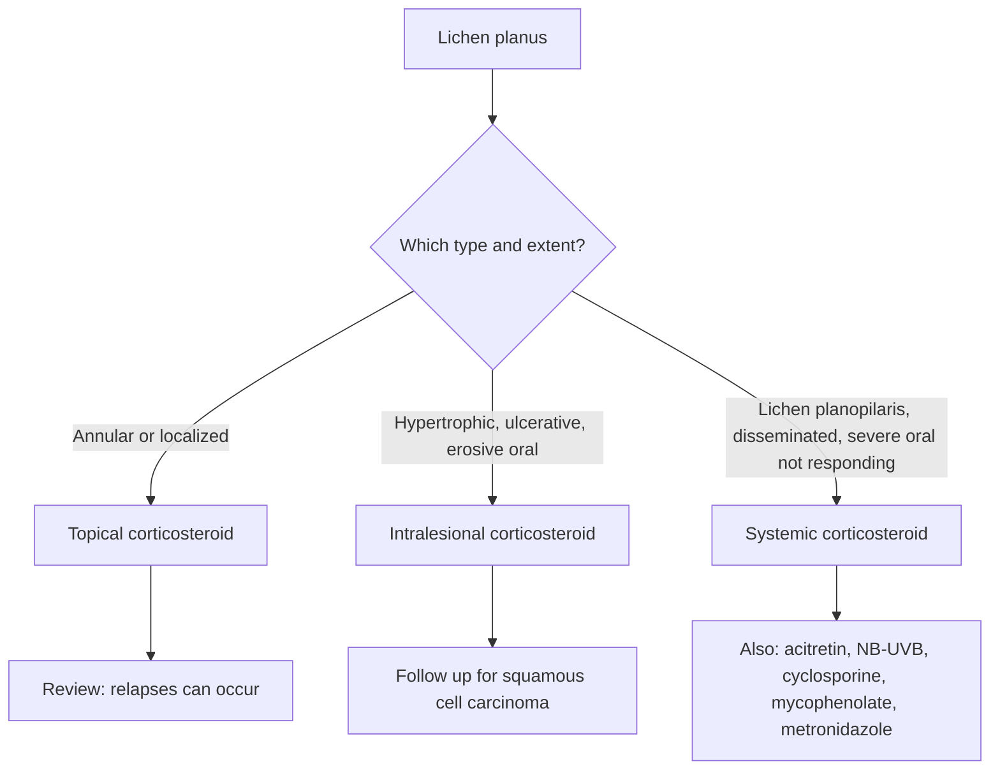

# 🟩 Lichen Planus - Practical

← [[Lichen Planus]] · Theory: [[Lichen Planus - Theory]] · Test: [[Lichen Planus - Exam]]

**Book pages:** 146 to 147 (treatment and Derma notes). The bedside parts follow the clinical features on pages 143 to 145. Anything marked ➕ is not in your book.

## A. Bedside routine

**History:** itch (how bad) · onset and course · **drug list** (ACE inhibitors, thiazides, antimalarials) · recent **influenza vaccine** · **hepatitis C** risk or known infection · other autoimmune disease (**alopecia areata, vitiligo**) · mouth soreness or pain on eating ➕ · nail changes · scalp itch or hair loss · genital symptoms · previous treatment and response ➕

**Exam:**
- [ ] Skin sites: flexor wrists and forearms, dorsal hands, shins, presacral area
- [ ] The lesion: **small polygonal violet flat-topped shiny papule**, sometimes umbilicated; clusters or plaques
- [ ] **Wickham striae** (fine white net). A drop of oil or water on the surface brings them out ➕
- [ ] **Koebner:** lines of papules along scratches
- [ ] **Mouth:** buccal mucosa on both sides, tongue, gums, lips: **lace pattern**, plaques, **erosions or ulcers**
- [ ] **Genitals:** glans penis (annular), vulva
- [ ] **Nails:** several nails, **pterygium**, ridging, fissuring, yellow color, onycholysis, subungual hyperkeratosis
- [ ] **Scalp:** violet scaly follicular papules, scarring, loss of follicle openings
- [ ] **Hypertrophic or ulcerative lesions** (cancer risk, needs follow-up)
- [ ] **Type** (§B)
- [ ] Signs of alopecia areata or vitiligo

## B. Type and extent

- Book: the treatment depends on **extent and type**
- **Worst types:** **hypertrophic** (lichenification that does not resolve), **ulcerative**, **lichen planopilaris**
- Commonest type: **papular**. Annular lesions on the **glans** are common
- ➕ Mouth disease is graded by form: reticular (painless) versus erosive or bullous (painful)

> [!warning] Severity is not only size
> Mouth erosions, scalp disease and nail disease can leave **permanent scars**. Site matters as much as extent.

## C. Investigations

Usually **clinical**. **Biopsy** if unclear, or for hypertrophic or ulcerative lesions. Histology: hyperkeratosis, **focal hypergranulosis**, irregular acanthosis, basal vacuolar degeneration, **band-like infiltrate**, **Civatte bodies** (see [[Lichen Planus - Theory]]).

➕ **Hepatitis C serology** (consider hepatitis B too) · ➕ **direct immunofluorescence** if the mouth or skin blisters or erodes, to separate it from pemphigoid or pemphigus · ➕ **dermoscopy:** Wickham striae · ➕ **KOH** if tinea is possible · ➕ **syphilis serology** if palms and soles or coppery lesions are involved

## D. Management: the decision path

### D1. Choose the corticosteroid route (book)

| Situation | Route | Why |
| --- | --- | --- |
| Localized, annular lesions | **Topical** corticosteroid | Surface disease, small area |
| **Hypertrophic**, **ulcerative**, and erosive mouth lesions | **Intralesional** corticosteroid | Thick or ulcerated lesions need the drug in the lesion |
| **Lichen planopilaris**, **disseminated** disease, **severe mouth disease** not responding to usual treatment | **Systemic** corticosteroid | Widespread or scarring disease |

### D2. Topical treatment

- **Annular lichen planus:** topical corticosteroid (book)
- ➕ Use a potent steroid on thick skin lesions under review; use a **low potency** steroid on the **face, folds and genitals**
- ➕ Mouth: topical steroid gel, paste or mouthwash. A calcineurin inhibitor (tacrolimus) is a steroid-sparing option
- Local steroid side effects: **atrophy, telangiectasia, striae, acne, folliculitis, purpura**. Regular review, as for any topical steroid. Details: [[Topical corticosteroids]]

> [!tip] Rule of thumb ➕
> Mild and small means topical. Thick, warty or ulcerated means inject. Scalp scarring, widespread or severe mouth disease means swallow.

### D3. Intralesional treatment

- For **hypertrophic** and **ulcerative** lichen planus, and erosive mouth lesions (book)
- ➕ A steroid suspension is injected into the thick plaque or the edge of the ulcer
- ➕ Warty or ulcerating lesions that keep growing need a **biopsy** to look for squamous cell carcinoma

### D4. Systemic treatment

- **Systemic corticosteroid:** for **lichen planopilaris**, **disseminated** disease, and **severe mouth disease** that does not respond to the usual treatment (book). Long courses have side effects (book)
- **Systemic retinoids (acitretin)** (book)
- **Narrow-band UVB** (book). See [[Phototherapy]]
- **Cyclosporine, metronidazole and mycophenolate** (book)

| Treatment | Used for | Watch ➕ |
| --- | --- | --- |
| Systemic corticosteroid | Lichen planopilaris, disseminated, severe mouth | Side effects of long use (book); taper the dose, check blood pressure, glucose and bones |
| Acitretin | Systemic retinoid option | Lipids and liver tests; **teratogenic for years after stopping** |
| Narrow-band UVB | Widespread skin disease | Burns; skin cancer risk with long use |
| Cyclosporine | Other option (book) | Blood pressure and kidney function |
| Mycophenolate | Other option (book) | Blood count and liver tests; avoid in pregnancy |
| Metronidazole | Listed in the book | Rarely used; confirm whether examiners expect it |

**The choice depends on:** type, extent, site (mouth, scalp, nails), previous treatment, and the patient ➕. Systemic treatment should be started by a dermatologist ➕.

## E. Special situations

- **Mouth, erosive or ulcerated:** intralesional or topical steroid. Ulcerated lesions may carry a higher cancer risk, especially in men (book). ➕ Stop smoking and alcohol, and arrange regular follow-up and dental review
- **Hypertrophic:** intralesional steroid. Risk of **keratoacanthoma and squamous cell carcinoma** (book). Biopsy any change
- **Lichen planopilaris:** systemic treatment. Scarring is permanent, so treat early ➕
- **Nails:** treat early ➕. **Pterygium** is permanent
- **Genital:** annular lesions on the glans respond to topical steroid; erosive vulval disease needs specialist follow-up ➕
- **Drug-induced** ➕: stop the suspected drug (ACE inhibitor, thiazide, antimalarial) if the rash began shortly after starting it, and ask the prescriber
- **Hepatitis C** ➕: screen, and refer if positive
- **Pregnancy** ➕: avoid acitretin and mycophenolate. Topical steroid and NB-UVB are the usual options; the specialist decides
- **Course (book):** may heal by itself within a year, with dark marks (post-inflammatory hyperpigmentation). Relapses can occur

## F. Counselling checklist

- [ ] Not contagious ➕
- [ ] May clear by itself, often within a year, but it can come back
- [ ] Dark marks after healing fade slowly
- [ ] Avoid scratching and skin injury (Koebner) ➕
- [ ] Long steroid use has side effects, so use as prescribed
- [ ] Mouth: report any sore or ulcer that does not heal ➕; avoid hot and spicy food in a flare ➕
- [ ] Stop smoking and alcohol if there is mouth disease ➕
- [ ] Review all medicines with the doctor
- [ ] Hypertrophic and ulcerative types need regular follow-up
- [ ] Report scalp hair loss early

## G. Connections

- **Treated with the same things as:** [[Psoriasis]] (phototherapy, acitretin). See [[Psoriasis management]]
- **Looks like:** see [[Papulosquamous DDx]]
- **Triggered by:** hepatitis C, influenza vaccine, ACE inhibitors, thiazides, antimalarials
- **Can lead to (if missed):** squamous cell carcinoma in hypertrophic and ulcerative types, scarring alopecia in lichen planopilaris. See [[Alopecia]]

**Mnemonic:** *Topical, Inject, Swallow.* Topical for small annular lesions, inject for thick or ulcerated ones, swallow (systemic) for scalp, widespread or severe mouth disease.

**Take-home:** There is no single treatment. Match the route to the type, and remember that the worst types are hypertrophic, ulcerative and lichen planopilaris.

See also: [[Lichen Planus]], [[Lichen Planus - Theory]]
