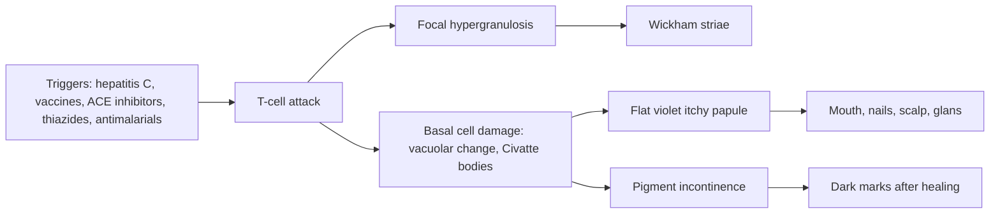

# 🟪 Lichen Planus

**Level:** #theory #practical #viva #papulosquamous

**Book pages:** 143 to 147 (chapter 11)

> [!success] CORE CARD (2 minutes)
> - **What:** idiopathic, **T-cell-mediated** inflammatory disease of **skin and mucous membranes**. Two-thirds start between **30 and 60**. No sex or race preference.
> - **Triggers:** **hepatitis C**, influenza vaccine, **ACE inhibitors, thiazides, antimalarials**. May go with **alopecia areata, vitiligo and hepatitis C**.
> - **Lesion:** small, **polygonal, violet, flat-topped, shiny papule**, itchy. May show fine white **Wickham striae** (focal hypergranulosis). Papules can cluster into plaques.
> - **Sites:** flexor wrists and forearms, dorsal hands, shins, presacral area. **Mouth in over half** (may be the only site). **Glans** (annular). Nails and scalp.
> - **Nails:** about **10%**. **Pterygium** is the most specific sign.
> - **Signs:** Wickham striae. [[Koebner phenomenon]] may be present.
> - **Histology:** hyperkeratosis, **hypergranulosis**, irregular acanthosis, basal vacuolar change, **band-like infiltrate**, **Civatte bodies**.
> - **Course:** may clear in **about 1 year**, leaves **dark marks** (pigment incontinence). Relapses happen.
> - **Worst types:** hypertrophic, ulcerative, lichen planopilaris. **SCC risk** in hypertrophic and ulcerative.
> - **Treat:** corticosteroid by extent. **Topical** (annular), **intralesional** (hypertrophic, ulcerative), **systemic** (lichen planopilaris, disseminated, severe oral). Also acitretin and [[Phototherapy]] (NB-UVB).
> - **Check ➕:** hepatitis C status and any new drug.

**Take-home:** Think lichen planus when you see itchy, flat-topped violet papules with white lines, and check the mouth, nails and scalp. Treat by extent, and watch hypertrophic and ulcerative types for cancer.

**Mnemonic ➕:** *The 6 Ps: Purple, Polygonal, Pruritic, Planar, Papules, Plaques.*

**Exam echo:** R2 Q34 (pterygium). R1 Q22 (annular on the glans), R1 Q35 (Civatte bodies). R2 Q4 (saw-tooth ridges and Civatte bodies appear as distractors for psoriasis).

### Revise in 4 ways

| Time you have | Do this |
| --- | --- |
| 2 min | Core card above |
| 20 min | [[Lichen Planus - Theory]] then [[Lichen Planus management]] |
| Active recall | [[Lichen Planus - Exam]] (traps, questions, flashcards) |
| Tell it apart | [[Papulosquamous DDx]] |

### Study Lichen Planus

- [[Lichen Planus - Theory]]: cause, lesion, sites, histology, types, mouth, nails, hair, course
- [[Lichen Planus management]]: bedside routine and which treatment for which type
- [[Lichen Planus - Exam]]: traps, case questions and flashcards
- [[Papulosquamous DDx]]: the look-alikes side by side

### Connections

- **Looks like:** [[Psoriasis]] (thick silvery scale, extensor sites, pitted nails), [[Secondary Syphilis]] (coppery, palms and soles, serology), [[Tinea Corporis]] (KOH shows hyphae), warts, drug eruption
- **Same sign:** [[Koebner phenomenon]] with [[Psoriasis]] and vitiligo. Nail pterygium belongs to lichen planus, nail pitting to [[Psoriasis]] and [[Alopecia]] (alopecia areata). Lichen planus itself can go with alopecia areata and vitiligo
- **Same test:** biopsy, as in [[Psoriasis]], with different findings. Terms in [[Skin Structure and Histology]]
- **Triggered by:** hepatitis C, influenza vaccine, ACE inhibitors, thiazides, antimalarials
- **Can lead to:** scarring alopecia ([[Alopecia]], lichen planopilaris), squamous cell carcinoma in hypertrophic and ulcerative types, dark marks after healing
- **Treated with the same things as:** [[Psoriasis]] (acitretin, narrow-band UVB). See [[Psoriasis management]]

### Book tick-list (pages 143 to 147)

- [ ] Idiopathic, T-cell-mediated disease of skin and mucosa; triggers (hepatitis C, vaccines, drugs); links with alopecia areata, vitiligo and hepatitis C
- [ ] Epidemiology: two-thirds between 30 and 60; no sex or race preference
- [ ] Common sites; mouth in over half; glans and vulva; nails; scalp
- [ ] The lesion: small polygonal violet flat-topped shiny papule, sometimes umbilicated; Wickham striae from focal hypergranulosis; dark marks; clustering into plaques; Koebner; itch
- [ ] Oral lichen planus: erosive and non-erosive, buccal mucosa, reticular pattern, painful erosive forms, malignant change in ulcerated lesions in men
- [ ] Nail lichen planus: about 10%, pterygium, ridging, fissuring, yellow color, onycholysis, subungual hyperkeratosis
- [ ] Follicular lichen planus (lichen planopilaris) and scarring alopecia
- [ ] Hypertrophic type, keratoacanthoma and squamous cell carcinoma
- [ ] The eight types and the three worst types
- [ ] Histology: all six findings
- [ ] Prognosis: healing within a year, pigment incontinence, relapses
- [ ] Complications
- [ ] Treatment by route, retinoids, narrow-band UVB, other drugs
- [ ] Differential diagnosis
- [ ] Derma notes: papular type commonest; six oral forms; which routes for which types

See also: [[Papulosquamous Lesions]], [[Papulosquamous Comparison]]
