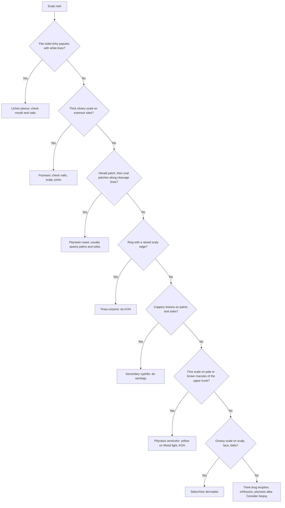

# 🟦 Papulosquamous DDx

← [[Papulosquamous Lesions]] · Tables: [[Papulosquamous Comparison]]

**Level:** #theory #practical #viva #papulosquamous

**Book pages:** the differential lists in the psoriasis (139), lichen planus (146) and pityriasis rosea (149) chapters, and erythrasma (70). Anything marked ➕ is not in the book.

### A. The decision path

### B. Tell-apart pairs (the favorite viva questions)

| Pair | One side | Other side | Deciding step |
| --- | --- | --- | --- |
| [[Psoriasis]] or [[Lichen Planus]] | Thick silvery scale, extensor sites, pitted nails, Auspitz | Flat violet itchy papules, Wickham striae, flexor wrists and shins, white lace in the mouth, nail pterygium | Look at the mouth and nails; biopsy |
| Guttate psoriasis or [[Pityriasis Rosea]] | Raindrop papules, fine scale, often after strep, no collarette | Herald patch, collarette, Christmas tree, settles in 6 to 8 weeks | Herald patch and the collarette |
| [[Pityriasis Rosea]] or [[Secondary Syphilis]] | Usually spares palms and soles, itches little | Coppery, not itchy, palms and soles, mucous patches, nodes | Syphilis serology if in any doubt |
| [[Pityriasis Versicolor]], [[Pityriasis Alba]] or vitiligo | Versicolor: fine scale, yellow Wood’s light. Alba: ill-defined, child’s cheek | Vitiligo: fully depigmented, sharp edge, no scale, accentuated white under Wood’s light | Wood’s light and KOH |
| Inverse psoriasis, tinea cruris or erythrasma | Inverse psoriasis: no scale, no active raised margin. Erythrasma: no raised edge | Tinea cruris: raised, scaly, advancing edge | Wood’s light (erythrasma glows coral red); KOH |
| [[Tinea Corporis]] or plaque [[Psoriasis]] | Ring, active scaly edge, clearing center | Thick silvery plaque, no central clearing | KOH |
| [[Seborrheic Dermatitis]] or [[Psoriasis]] (scalp, face) | Greasy yellowish scale, folds and face | Thick silvery scale, other sites involved | Look for psoriasis elsewhere; ➕ sebopsoriasis can overlap |
| [[Lichen Planus]] or a drug eruption ➕ | Starts after a new drug, may need a biopsy | Classic sites, mouth involved | History and course after stopping the drug |

### C. Checklist before you commit to a diagnosis

- [ ] Where is it, and is it symmetrical?
- [ ] What kind of scale?
- [ ] Mouth, nails, scalp, palms and soles examined?
- [ ] Any new drug or recent infection or vaccine?
- [ ] KOH if there is any ring or edge ➕
- [ ] Syphilis serology if palms and soles, or coppery lesions ➕
- [ ] Biopsy if still unclear

> [!warning] Two look-alikes you can treat
> **Tinea** and **syphilis** are the two treatable look-alikes. Test for both before treating a stubborn scaly rash as psoriasis, especially after steroids have altered the picture ➕.

### D. Connections

- **Looks like:** every disease in the path above
- **Same test:** KOH and biopsy ([[Dermatology Investigations]])
- **Can lead to (if missed):** untreated tinea and syphilis, or wrong long-term steroid use

**Mnemonic:** *Violet, Silver, Herald, Ring, Copper, Fine, Greasy.* The seven questions in order: lichen planus, psoriasis, pityriasis rosea, tinea, syphilis, versicolor, seborrheic dermatitis.

**Take-home:** Ask the same questions in the same order every time, and finish with the two treatable look-alikes.

See also: [[Papulosquamous Lesions]], [[Papulosquamous Comparison]], [[Psoriasis]], [[Lichen Planus]]
