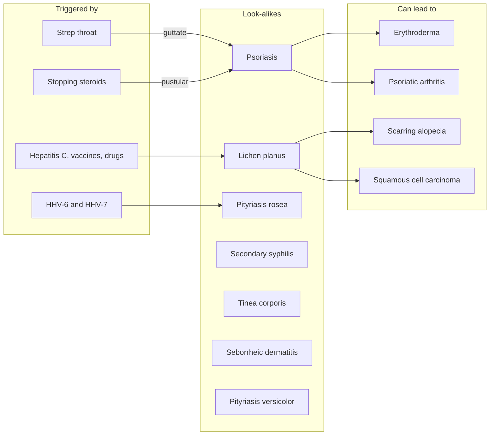

# 🟪 Papulosquamous Lesions

**Level:** #theory #practical #viva #papulosquamous

**Book pages:** psoriasis 132 to 142 · lichen planus 143 to 147 · pityriasis rosea 148 to 149 · erythrasma 70 · tinea corporis 75 · pityriasis versicolor 81 to 82 · seborrheic dermatitis 111 to 113 · pityriasis alba 118 · ichthyosis 22 to 24 · secondary syphilis 204 to 205 · erythroderma 215 to 216

> [!success] CORE CARD (2 minutes)
> - **What:** diseases with raised **papules or plaques** (papulo-) topped with **scale** (-squamous). Examiners use the word for a group of scaly rashes that look alike and must be told apart.
> - **Three questions:** **Where** is it? **What scale** is it? **What else** is there (nails, mouth, palms and soles, itch, what happened before)?
> - **Scale to disease:** thick silvery = **psoriasis** · flat violet shiny with white lines = **lichen planus** · collarette = **pityriasis rosea** · fine branny = **pityriasis versicolor** · greasy = **seborrheic dermatitis** · scale on the raised edge of a ring = **tinea corporis** · coppery with palms and soles = **secondary syphilis**
> - **Same sign:** [[Koebner phenomenon]] (psoriasis, lichen planus, vitiligo, warts) · nail pitting (psoriasis, alopecia areata) · pterygium and white lace in the mouth (lichen planus) · geographic tongue (psoriasis) · palms and soles (syphilis, palmoplantar psoriasis; usually spared in pityriasis rosea)
> - **Same test:** Wood’s light (versicolor yellow, erythrasma coral red, tinea capitis green, vitiligo white) · KOH (tinea, versicolor) · biopsy (psoriasis, lichen planus)
> - **Triggers:** strep throat gives guttate psoriasis · stopping steroids gives pustular psoriasis · hepatitis C, vaccines and drugs give lichen planus · HHV-6 and HHV-7 are linked to pityriasis rosea
> - **Can lead to:** psoriasis to erythroderma and arthritis · lichen planus to scarring alopecia and squamous cell cancer
> - **Exam:** scaly diseases are about 9 to 11 questions in each paper, roughly a quarter.

**Take-home:** Never name a scaly rash from its color alone. The scale type, the site and one extra clue (nails, mouth, palms, Wood’s light) usually decide it.

**Mnemonic:** *Where, What, What else.*

### Revise in 4 ways

| Time you have | Do this |
| --- | --- |
| 2 min | Core card above |
| 20 min | [[Papulosquamous Comparison]] then [[Papulosquamous DDx]] |
| Active recall | The Exam note of each disease, for example [[Lichen Planus - Exam]] |
| By disease | The list below |

### Study the group

**Core group**
- [[Psoriasis]]
- [[Lichen Planus]]
- [[Pityriasis Rosea]]
- [[Pityriasis Versicolor]]
- [[Seborrheic Dermatitis]]
- [[Tinea Corporis]]
- [[Secondary Syphilis]]

**Other scaly conditions (scaly, but not truly papulosquamous)**
- [[Ichthyosis]]
- [[Pityriasis Alba]]

**Neighbors that connect to the group**
- [[Erythroderma]]: where psoriasis, lichen planus and others can end up
- [[Drug Eruptions]]: can copy almost every disease above
- [[Alopecia]]: nail pitting is shared with psoriasis, and lichen planus can scar the scalp
- Pityriasis rubra pilaris and small plaque parapsoriasis are only named in the book’s differential lists

### A. Step 1: three questions

1. **Where is it?** Look at the distribution first.
2. **What kind of scale is it?** Use the table in §B.
3. **What else is there?** Nails, mouth, palms and soles, itch, and what happened before the rash.

### B. The scale or lesion points to

| The scale or lesion | Points to |
| --- | --- |
| Thick, silvery, layered scale on well-defined red plaques | [[Psoriasis]] |
| Flat-topped, shiny, violet, itchy papules with fine white lines | [[Lichen Planus]] |
| Oval salmon patches with a ring of fine scale just inside the edge | [[Pityriasis Rosea]] |
| Fine branny scale on pale or brown macules of the upper trunk | [[Pityriasis Versicolor]] |
| Greasy yellowish scale on the scalp, face and folds | [[Seborrheic Dermatitis]] |
| Scale at a raised active edge with a clearing center (a ring) | [[Tinea Corporis]] |
| Coppery papules that include the palms and soles | [[Secondary Syphilis]] |
| Dry gray-brown fish-like scale | [[Ichthyosis]] |
| Fine scale on pale, ill-defined patches on a child’s cheeks | [[Pityriasis Alba]] |

### C. Follow the connections

**Looks like (tell these pairs apart):** see [[Papulosquamous DDx]]
- [[Psoriasis]] and [[Lichen Planus]]
- Guttate psoriasis and [[Pityriasis Rosea]]
- [[Pityriasis Rosea]] and [[Secondary Syphilis]]
- [[Tinea Corporis]] and [[Psoriasis]]
- [[Pityriasis Versicolor]], [[Pityriasis Alba]] and vitiligo

**Same sign**
- **Koebner phenomenon:** psoriasis, lichen planus, vitiligo, warts
- **Nail pitting:** psoriasis and alopecia areata
- **Nail pterygium and white lace in the mouth:** lichen planus
- **Geographic tongue:** psoriasis
- **Palms and soles:** often involved in secondary syphilis and palmoplantar psoriasis, usually spared in pityriasis rosea

**Same test**
- **Wood’s light:** pityriasis versicolor (yellow), erythrasma (coral red), tinea capitis (green), vitiligo (accentuated white)
- **KOH scraping:** tinea corporis and pityriasis versicolor
- **Biopsy:** the final answer for psoriasis and lichen planus

**Triggered by**
- Streptococcal throat infection: guttate psoriasis
- Steroid withdrawal: pustular psoriasis
- Hepatitis C, influenza vaccine, ACE inhibitors, thiazides, antimalarials: lichen planus
- HHV-6 and HHV-7 reactivation: linked to pityriasis rosea

**Can lead to**
- Psoriasis: erythroderma and psoriatic arthritis
- Lichen planus: scarring alopecia (lichen planopilaris) and, in hypertrophic and ulcerative types, squamous cell cancer

**Treated with the same things**
- Phototherapy: psoriasis, lichen planus, pityriasis rosea. See [[Phototherapy]]
- Acitretin: psoriasis, lichen planus, severe seborrheic dermatitis
- Topical steroids: most of the group, but oral steroids can destabilize psoriasis

### D. The connection map

### E. Where each disease appeared in the exams

| Disease | R2 (second rotation) | R1 (first round) |
| --- | --- | --- |
| Psoriasis | Q4 Munro microabscesses, Q16 geographic tongue, Q22 parakeratosis | Q15 guttate, Q16 pustular after steroids, Q26 dermoscopy |
| Lichen planus | Q34 pterygium | Q22 annular on the glans, Q35 Civatte bodies |
| Pityriasis rosea | Q25, Q27 | Q33 |
| Pityriasis versicolor | Q7, Q8, Q29 | none |
| Pityriasis alba | Q28 | Q39 |
| Ichthyosis | Q17 X-linked, dirty neck | Q36 inheritance |

The same topics come back in both papers. Pityriasis rosea, X-linked ichthyosis, psoriasis histology and lichen planus signs are the safest to learn first.

See also: [[Papulosquamous Comparison]], [[Papulosquamous DDx]], [[Skin Examination]], [[Secondary Skin Lesions]]
