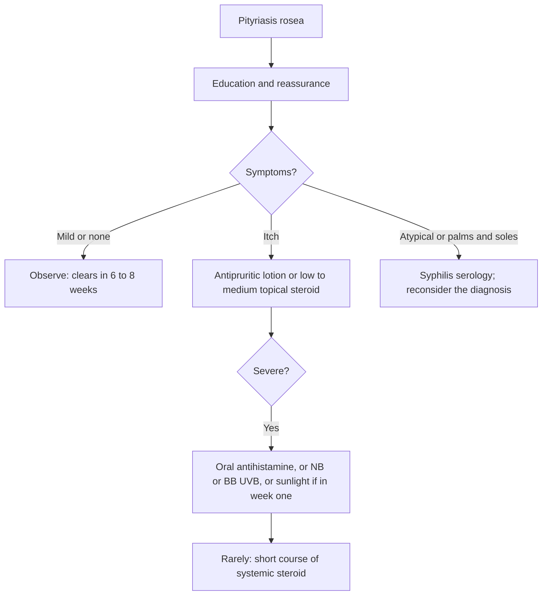

# 🟩 Pityriasis Rosea - Practical

← [[Pityriasis Rosea]] · Theory: [[Pityriasis Rosea - Theory]] · Test: [[Pityriasis Rosea - Exam]]

**Book pages:** 148 to 149. Anything marked ➕ is not in your book.

## A. Bedside routine

**History:** was there **one patch first**, and when? (herald patch hours to days before) · when did the rash spread? (1 to 2 weeks later) · itch (few, if any, symptoms) · **new drugs** (captopril, barbiturates) · season (spring or fall) ➕ · recent sore throat or cold ➕ · **sexual history** ➕ · pregnancy ➕ · family or contacts with a similar rash ➕ · previous episodes (recurrence is uncommon) · use of strong soaps, heat, sweating ➕

**Exam:**
- [ ] **Herald patch:** oval, 2 to 4 cm, salmon-red, slightly raised advancing margin, **collarette** at the margin. Look on the trunk, neck, proximal limbs
- [ ] **Exanthem:** smaller thin scaling oval patches and papules with collarettes, dull pink or tawny
- [ ] **Pattern:** along the **lines of cleavage** (Christmas tree)
- [ ] **Sites:** trunk and proximal arms and legs
- [ ] **Face, palms and soles:** usually spared. If involved, think syphilis
- [ ] **Atypical forms:** face and neck only; herald absent or multiple; vesicular or erythema multiforme-like (irritata)
- [ ] Look for signs of **secondary syphilis** ➕: palm and sole lesions, mouth patches, genital warty lesions (condylomata lata), generalized lymph nodes
- [ ] Ask about **drugs** and examine for a drug rash

## B. Typical or atypical?

| Type | What you see | Action |
| --- | --- | --- |
| **Typical** | Herald patch, then Christmas tree rash on trunk and proximal limbs | Reassure; treat symptoms |
| **Face and neck only** | Rash restricted to face and neck | Consider other diagnoses; serology ➕ |
| **Herald absent, multiple or the only sign** | No classic start | Think of look-alikes; serology ➕ |
| **Irritata** | Vesicular or erythema multiforme-like, from sweat or inadequate treatment | Remove irritants ➕; keep treatment simple |

> [!warning] Palms and soles
> The face, palms and soles are **usually but not always** spared. Palm and sole involvement points to **secondary syphilis**, so test.

## C. Investigations

Usually **clinical**.

- **Syphilis serology** when there is any doubt (book). ➕ Always in a sexually active patient, with palm and sole lesions, or with an atypical picture
- **Biopsy** is rarely needed. Histology: patchy or diffuse parakeratosis, absent granular layer, psoriasiform hyperplasia, focal spongiosis, red cell extravasation (see [[Pityriasis Rosea - Theory]])
- ➕ **KOH** if tinea corporis is possible
- ➕ Review the **drug list** if a drug eruption is possible

## D. Management: the decision path

### D1. Treatment steps (book)

| Step | Treatment | Notes |
| --- | --- | --- |
| 1 | **Patient education and reassurance** | The disease is self-limited and clears in 6 to 8 weeks |
| 2 | **Symptomatic:** antipruritic lotions or **low to medium-strength topical corticosteroids** | For itch |
| 3 | **Oral antihistamines**, or **phototherapy** (narrow-band or broad-band UVB), or **natural sunlight** | In more severe cases. Sunlight only helps if started in the **first week** of the eruption. See [[Phototherapy]] |
| 4 | **Short course of systemic corticosteroid** | **Rarely** needed |

> [!tip] Rule of thumb ➕
> Reassure first. Treat the itch, not the rash. Escalate only when symptoms are severe.

### D2. What not to do ➕

- Do not use strong steroids or harsh treatment on the rash: this can cause the **irritata** form (book: inadequate treatment and sweat irritation)
- Do not give antibiotics without a reason
- Do not forget to stop a suspected drug

## E. Special situations

- **Atypical forms:** face and neck only, herald absent or multiple. Think of other diagnoses and send syphilis serology ➕
- **Irritata:** vesicular or erythema multiforme-like. Caused by sweat and by inadequate treatment (book). ➕ Simplify care, avoid irritants and heat
- **Palms and soles involved:** exclude **secondary syphilis** (book: unlike syphilis, these are usually spared)
- **Drug eruption** ➕: stop the suspected drug (captopril, barbiturates are named in the book) and ask the prescriber
- **Pregnancy** ➕: reassure, avoid unnecessary drugs, and involve the obstetric team
- **Recurrence (book):** uncommon but reported

## F. Counselling checklist

- [ ] It is a **harmless, self-limited** rash
- [ ] It usually clears by itself in **6 to 8 weeks**
- [ ] Recurrence is **uncommon**
- [ ] Itch can be treated with a lotion or a mild steroid
- [ ] Avoid heat, sweating and harsh soaps ➕
- [ ] Not considered contagious ➕
- [ ] Return if there is **fever, mouth sores, palm or sole lesions**, or the rash does not clear in 8 weeks ➕
- [ ] Dark or pale marks may follow in darker skin and fade ➕

## G. Connections

- **Treated with the same things as:** [[Psoriasis]] and [[Lichen Planus]] (phototherapy). See [[Psoriasis management]] and [[Lichen Planus management]]
- **Looks like:** see [[Papulosquamous DDx]]
- **Triggered by:** HHV-6 and HHV-7 reactivation (suggested)
- **Can lead to (if missed):** missed secondary syphilis. See [[Secondary Syphilis]]

**Mnemonic:** *Reassure, Relieve, Reconsider.* Reassure everyone, relieve the itch, and reconsider the diagnosis if it is atypical or involves the palms and soles.

**Take-home:** Do nothing harmful. Educate, treat the itch, and test for syphilis whenever the picture is not classic.

See also: [[Pityriasis Rosea]], [[Pityriasis Rosea - Theory]]
