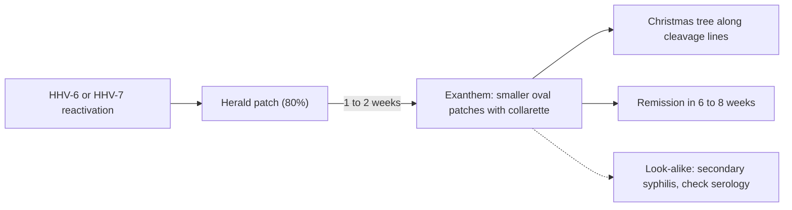

# 🟪 Pityriasis Rosea

**Level:** #theory #practical #viva #papulosquamous

**Book pages:** 148 to 149 (chapter 12)

> [!success] CORE CARD (2 minutes)
> - **What:** a common, **acute, self-limited** skin disease. Peak in **adolescence** (10 to 35). Rare in infants and the elderly. No racial predilection. **Spring and fall**.
> - **Cause:** viral is proposed. Linked to **reactivation of HHV-7 or HHV-6**.
> - **Herald patch (80%):** one lesion, usually on the **trunk**, appearing **hours to days before** the rash. **Oval, 2 to 4 cm, salmon-red**, slightly raised advancing margin, **fine collarette scale at the margin**.
> - **Exanthem:** **1 to 2 weeks later**. Many smaller, thin, scaly, dull pink or tawny **oval patches with collarettes**, scattered along the **lines of cleavage** (**Christmas tree** pattern).
> - **Sites:** trunk and proximal arms and legs. **Face, palms and soles usually spared** (unlike syphilis).
> - **Atypical:** face and neck only · herald patch absent, multiple, or the only sign · **irritata** (vesicular or erythema multiforme-like).
> - **Look-alikes:** secondary syphilis (**get serology**), guttate psoriasis (**no collarette**), drug eruption (captopril, barbiturates), parapsoriasis, erythema multiforme, tinea corporis.
> - **Histology:** parakeratosis, absent granular layer, focal spongiosis, red cell extravasation.
> - **Course:** remission in **6 to 8 weeks**. Recurrence uncommon. Most have few, if any, symptoms.
> - **Treat:** **education and reassurance**, then symptomatic: antipruritic lotion or **low to medium topical steroid**. Severe: oral antihistamine, **NB or BB UVB**, or sunlight if started in week one. Rarely a short systemic steroid.

**Take-home:** Think pityriasis rosea when a herald patch is followed by oval collarette patches along the cleavage lines. It clears by itself in 6 to 8 weeks, so reassure. Always remember that secondary syphilis is the look-alike you must not miss.

**Mnemonic ➕:** *Herald, Collarette, Christmas tree.* The three words that name it.

**Exam echo:** R2 Q25 (herald patch then Christmas tree), R2 Q27 (palms and soles uncommonly involved), R1 Q33 (salmon patch then smaller papules).

### Revise in 4 ways

| Time you have | Do this |
| --- | --- |
| 2 min | Core card above |
| 20 min | [[Pityriasis Rosea - Theory]] then [[Pityriasis Rosea management]] |
| Active recall | [[Pityriasis Rosea - Exam]] (traps, questions, flashcards) |
| Tell it apart | [[Papulosquamous DDx]] |

### Study Pityriasis Rosea

- [[Pityriasis Rosea - Theory]]: epidemiology, cause, herald patch, exanthem, atypical forms, histology, course
- [[Pityriasis Rosea management]]: bedside routine and treatment steps
- [[Pityriasis Rosea - Exam]]: traps, case questions and flashcards
- [[Papulosquamous DDx]]: the look-alikes side by side

### Connections

- **Looks like:** [[Secondary Syphilis]] (palms and soles, not itchy, serology), guttate [[Psoriasis]] (no collarette), [[Tinea Corporis]] (KOH), drug eruption, small plaque parapsoriasis, erythema multiforme
- **Same sign:** the fine collarette scale. ➕ The herald patch can look like tinea corporis
- **Same test:** histology shares parakeratosis and an absent granular layer with [[Psoriasis]], so the picture decides, not the slide
- **Triggered by:** reactivation of HHV-6 and HHV-7 (suggested)
- **Can lead to:** nothing lasting. It is self-limited. ➕ Dark or pale marks may follow in darker skin
- **Treated with the same things as:** [[Psoriasis]] and [[Lichen Planus]] (phototherapy). See [[Phototherapy]]

### Book tick-list (pages 148 to 149)

- [ ] Common, acute, self-limited; peak 10 to 35; rare in infants and elderly; no racial predilection; spring and fall
- [ ] Viral etiology; HHV-7 and HHV-6 reactivation
- [ ] Herald patch: 80%, hours to days before, solitary, trunk, 2 to 4 cm, salmon-red, advancing margin, collarette, may be multiple
- [ ] Less often the herald patch is on the neck or proximal limbs
- [ ] Exanthem: 1 to 2 weeks later, smaller thin scaling lesions with collarettes, dull pink or tawny, along cleavage lines (Christmas tree)
- [ ] Confined to trunk and proximal limbs; face, palms and soles usually but not always spared (unlike syphilis)
- [ ] Atypical forms: face and neck only; herald absent, multiple or the only sign; irritata
- [ ] Differential diagnosis: all six
- [ ] Histology: all six findings
- [ ] Course: 6 to 8 weeks; recurrences uncommon; few symptoms
- [ ] Management: education, antipruritics, low to medium steroids, antihistamines, phototherapy, sunlight, rare systemic steroid

See also: [[Papulosquamous Lesions]], [[Papulosquamous Comparison]]
