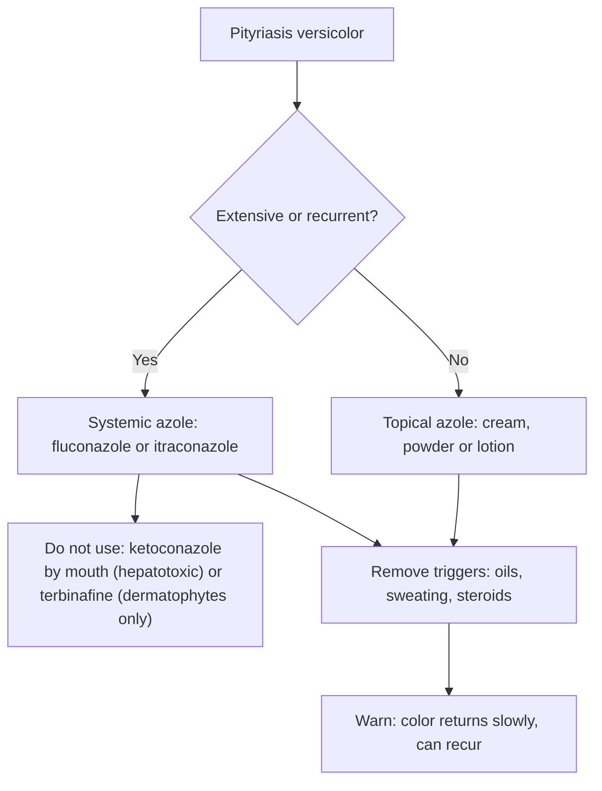

# 🟩 Pityriasis Versicolor - Practical

← [[Pityriasis Versicolor]] · Theory: [[Pityriasis Versicolor - Theory]] · Test: [[Pityriasis Versicolor - Exam]]

**Book pages:** 81 to 82 (the disease) and 86 to 87 (treatment of fungal infection). Anything marked ➕ is not in your book.

## A. Bedside routine

**History:** how long · season and sun exposure ➕ · **sweating**, **oily skin**, **use of oils** (olive oil) · **steroid use** (creams or tablets) · **pregnancy** · **immunodeficiency**, poor nutrition · itch (usually none) · main complaint (cosmetic) · atopy (to think of pityriasis alba) ➕ · previous treatment and recurrences ➕

**Exam:**
- [ ] **Color** of the patches: hyperpigmented, hypopigmented, or transient pink
- [ ] **Fine branny scale.** Scrape gently with a fingernail or blunt edge to bring it out ➕
- [ ] **Follicular pattern:** pinpoint lesions around hair follicles
- [ ] **Distribution:** upper trunk (front and back) and shoulders, the short jacket pattern
- [ ] **Other sites:** face (children), scalp, antecubital fossae, under the breasts, groin
- [ ] **Flexures:** inverse pityriasis versicolor
- [ ] **Wood’s light** in a dark room: bright yellow
- [ ] **KOH scraping:** hyphae and round yeast
- [ ] Rule out vitiligo: **no scale, fully white** ➕
- [ ] Rule out the other look-alikes (§B of the DDx note)

## B. Type and extent

| Type | What you see | Note |
| --- | --- | --- |
| **Typical** | Seborrheic distribution: upper trunk and shoulders | Commonest |
| **Follicular** | Pinpoint lesions around follicles | A special pattern |
| **Inverse** | Flexures | Easy to mistake for other diseases |
| **Facial (children)** | Face | Think of pityriasis alba too |
| **Post-eruptive hypopigmentation** | Pale patches, no scale, Wood’s light not yellow | Fungus gone, color slowly recovering |
| **Extensive** | Large area of the trunk and limbs | Indication for systemic treatment (book) |

> [!warning] Active or post-eruptive?
> Fine scale means active disease. **No scale does not mean post-eruptive**, so use the Wood’s light. Treat only when the disease is still active.

## C. Investigations

- **Wood’s light:** bright yellow fluorescence. Used for screening
- **KOH scraping (10 to 20%):** **spaghetti and meatballs**, meaning hyphae and round yeast forms
- **Culture:** generally **not needed** (book)
- ➕ **Biopsy:** not needed
- ➕ Check for **steroid use** and other triggers

## D. Management: the decision path

### D1. Topical treatment

- **Topical azoles** (book): ketoconazole, itraconazole, miconazole, clotrimazole, econazole, isoconazole, tioconazole. Forms: **cream, powder, lotion**
- ➕ **Selenium sulfide** lotion or shampoo and **ketoconazole shampoo** are also commonly used on the trunk. Confirm which your faculty teaches
- ➕ Cover the whole area of the trunk and shoulders, not only the visible patches

### D2. Systemic treatment

**Indication (book):** **extensive** disease.

| Drug | Notes (book) |
| --- | --- |
| **Fluconazole** | Active against dermatophytes, **yeast** and some non-dermatophyte molds. Skin infection regimens in the book: **100 mg daily for 2 to 4 weeks**, or **150 mg weekly for 2 to 3 weeks** |
| **Itraconazole** | Fungistatic; active against dermatophytes, **yeast** and most non-dermatophyte molds. Skin infection regimen in the book: **100 to 400 mg daily for 2 to 4 weeks** |
| **Ketoconazole** | **Hepatotoxic. Not used** |
| **Terbinafine** | Fungicidal, but **active against dermatophytes only**. It does **not** cover the yeast, so it does not suit pityriasis versicolor |
| **Griseofulvin** | Active against dermatophytes; ➕ not used for yeast infection |

> [!warning] ➕ Regimens
> The doses above are the book’s general skin infection regimens. Short regimens specific to pityriasis versicolor exist in practice. Confirm the exact regimen with your doctors and examiners.

### D3. Remove the triggers

- Stop or reduce **oils** on the skin (book lists them as a trigger)
- **Steroids:** reduce or stop them if possible (book lists steroid use as a trigger)
- Control **sweating** and heat ➕
- Treat underlying **immunodeficiency** or nutrition problems ➕

## E. Special situations

- **Extensive disease:** systemic azole (book)
- **Children:** the face is a common site. Think of pityriasis alba too
- **Pregnancy** ➕: avoid oral azoles; use a topical agent
- **On steroids or immunosuppressed:** more likely to recur ➕; see D3
- **Post-eruptive hypopigmentation:** the fungus is gone. Reassure; color recovers slowly. No more antifungal is needed ➕
- **Recurrent disease** ➕: repeat the topical treatment, and ask about the triggers. A periodic preventive azole wash is sometimes used; confirm with your doctors

## F. Counselling checklist

- [ ] It is a **superficial yeast infection**, not dirt and not serious
- [ ] The **color** returns **slowly** after cure, because the fungus inhibits melanin
- [ ] It **can come back**, especially in hot, humid, sweaty weather ➕
- [ ] Avoid **oils** on the skin
- [ ] Avoid unneeded **steroid** creams
- [ ] Apply the antifungal to the **whole area**, not just the patches ➕
- [ ] It is not usually considered contagious ➕
- [ ] Return if it is **not improving**, or if the picture changes ➕

## G. Connections

- **Treated with the same things as:** [[Tinea Corporis]] (topical and systemic azoles), [[Seborrheic Dermatitis]] (ketoconazole)
- **Looks like:** see [[Papulosquamous DDx]]
- **Triggered by:** heat, humidity, sweating, oily skin, oils, steroids, pregnancy, immunodeficiency
- **Can lead to (if untreated):** persistent cosmetic disfigurement; post-eruptive hypopigmentation

**Mnemonic:** *Azole on, Oil off.* Use an azole, and remove the oils and other triggers.

**Take-home:** Azole on the trunk, azole by mouth only if extensive, never ketoconazole or terbinafine by mouth. The color comes back slowly, and the yeast can return.

See also: [[Pityriasis Versicolor]], [[Pityriasis Versicolor - Theory]]
