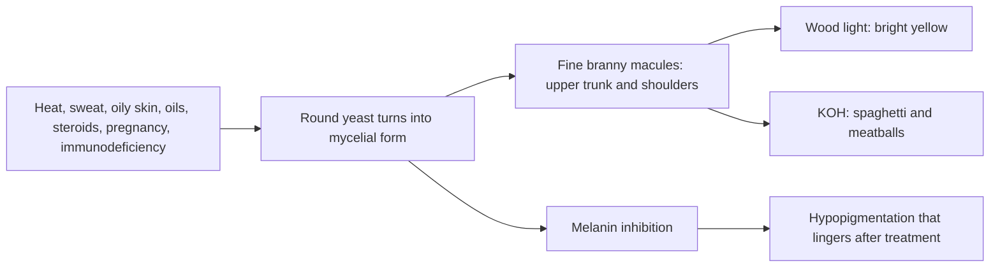

# 🟪 Pityriasis Versicolor

**Level:** #theory #practical #viva #papulosquamous

**Book pages:** 81 to 82 (the disease) and 86 to 87 (treatment of fungal infection)

> [!success] CORE CARD (2 minutes)
> - **What:** a superficial skin infection by a **lipophilic yeast**, *Malassezia furfur* or *globosa*. It lives on normal skin in tiny amounts (not seen on KOH). **Disease** appears when the **round yeast form turns into the mycelial form**.
> - **Age:** any age, but **common in adults** (after puberty).
> - **What switches it on:** heat and humidity · oily skin · excessive sweating · immunodeficiency · poor nutrition · pregnancy · **corticosteroid use** · application of oils (for example olive oil).
> - **Lesion:** multiple **oval to round macules and patches** with **mild, fine, branny scale**. Can be **hyperpigmented or hypopigmented**. Transient pink color if mildly inflamed. May be **follicular** (pinpoint around the hair follicles).
> - **Sites:** **seborrheic areas**: upper trunk (front and back) and shoulders (**short jacket with short sleeves**). Less often face (children), scalp, antecubital fossae, under the breasts, groin. **Flexural** involvement is **inverse** pityriasis versicolor.
> - **Symptom:** usually **none**. The main complaint is **cosmetic**.
> - **Hypopigmentation after treatment:** reduced tanning and **melanin inhibition** by the fungus.
> - **Tests:** **Wood’s light: bright yellow**. **KOH: spaghetti and meatballs** (hyphae and round yeast). Culture is not needed.
> - **Look-alikes:** pityriasis alba, post-inflammatory hypopigmentation, **vitiligo**, seborrheic dermatitis, pityriasis rosea, tinea corporis, secondary syphilis, progressive macular hypomelanosis.
> - **Treat:** topical **azoles**. **Extensive** disease: **systemic azole** (fluconazole or itraconazole). **Ketoconazole by mouth is hepatotoxic (not used). Terbinafine works on dermatophytes only.**

**Take-home:** Fine branny scale on pale or brown macules of the upper trunk, a yellow Wood’s light, and spaghetti and meatballs on KOH. Treat with an azole, and warn that the color returns slowly and the infection tends to return.

**Mnemonic ➕:** *Yellow lamp, Spaghetti slide, Short jacket.* Wood’s light, KOH picture, and the distribution.

**Exam echo:** R2 Q7, Q8 and Q29 (all three give yellow Wood’s light). Related: R2 Q28 and R1 Q39 (pityriasis alba), R1 Q25 (which fungus fluoresces).

### Revise in 4 ways

| Time you have | Do this                                                                      |
| ------------- | ---------------------------------------------------------------------------- |
| 2 min         | Core card above                                                              |
| 20 min        | [[Pityriasis Versicolor - Theory]] then [[Pityriasis Versicolor management]] |
| Active recall | [[Pityriasis Versicolor - Exam]] (traps, questions, flashcards)              |
| Tell it apart | [[Papulosquamous DDx]]                                                       |

### Study Pityriasis Versicolor

- [[Pityriasis Versicolor - Theory]]: cause, triggers, lesion, sites, tests, color change, differential
- [[Pityriasis Versicolor management]]: bedside routine and treatment
- [[Pityriasis Versicolor - Exam]]: traps, case questions and flashcards
- [[Papulosquamous DDx]]: the look-alikes side by side

### Connections

- **Looks like:** [[Pityriasis Alba]] (child’s cheeks, atopic, no yellow light), vitiligo (no scale, fully white), [[Seborrheic Dermatitis]], [[Pityriasis Rosea]], [[Tinea Corporis]], [[Secondary Syphilis]]
- **Same sign:** fine branny scale (see [[Secondary Skin Lesions]]); seborrheic distribution, shared with [[Seborrheic Dermatitis]]
- **Same test:** **Wood’s light** with erythrasma (coral red), tinea capitis (green), vitiligo (white). **KOH** with [[Tinea Corporis]]. See [[Dermatology Investigations]]
- **Triggered by:** heat, sweating, oils, steroids, pregnancy, immunodeficiency
- **Can lead to:** post-eruptive hypopigmentation that fades slowly
- **Treated with the same things as:** [[Tinea Corporis]] (azoles) and [[Seborrheic Dermatitis]] (ketoconazole)

### Book tick-list (pages 81 to 82 and 86 to 87)

- [ ] Lipophilic yeast; normally invisible on KOH; disease when round yeast becomes mycelial; *Malassezia furfur* or *globosa*; any age, common in adults
- [ ] The eight factors that promote the change
- [ ] Morphology: oval to round macules, fine branny scale, follicular pattern, hyper or hypopigmented, transient pink color, asymptomatic, cosmetic
- [ ] Secondary hypopigmentation: reduced tanning and melanin inhibition
- [ ] Distribution: upper trunk and shoulders, face in children, scalp, antecubital fossae, under the breasts, groin; inverse form
- [ ] KOH: spaghetti and meatballs; culture not needed
- [ ] Wood’s light: bright yellow; active disease against post-eruptive hypopigmentation
- [ ] The eight differentials
- [ ] General diagnosis of superficial fungal infection: history, picture, Wood’s light, KOH 10 to 20%, culture
- [ ] Systemic treatment for extensive disease; the book’s azole regimens
- [ ] Ketoconazole by mouth is hepatotoxic; terbinafine works on dermatophytes only
- [ ] Topical azoles (cream, powder, lotion)

See also: [[Papulosquamous Lesions]], [[Papulosquamous Comparison]]
