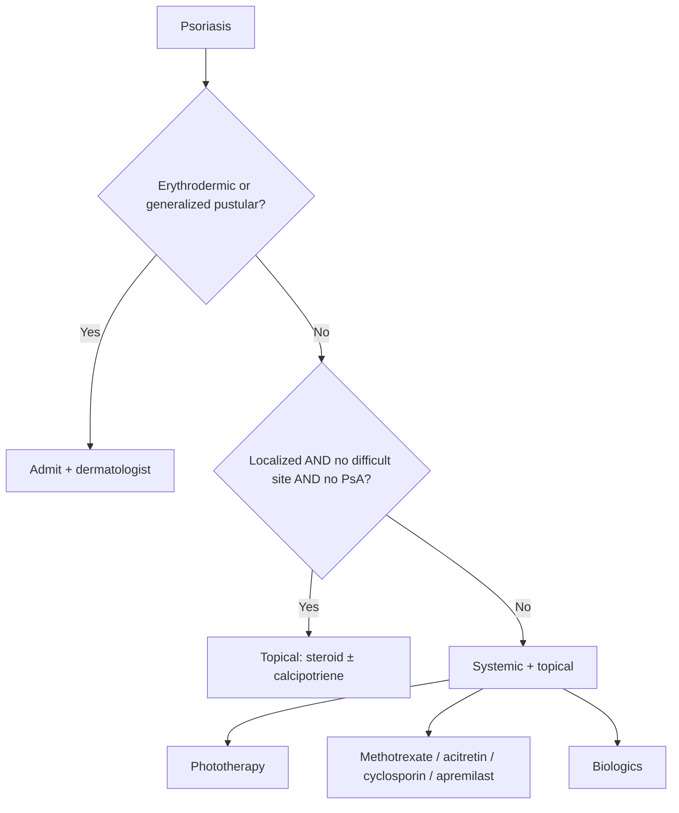

# 🟩 Psoriasis - Practical
← [[Psoriasis]] · Test: [[Psoriasis - Exam]]

## A. Bedside routine
**History:** onset and course · family · recent sore throat · recent steroid · **drug list** (LIBAN + S) · joint stiffness (worse after rest) · nails · stress, smoking, alcohol.
**Exam:**
- [ ] Sites: scalp, elbows, knees, sacrum, folds, palms/soles, genitals
- [ ] Scale · Auspitz · Koebner
- [ ] **Nails** (pitting, oil-drop, onycholysis)
- [ ] **Joints** (DIP, dactylitis, entheses)
- [ ] **Severity** (§B)
- [ ] Red flags: fever, generalized redness or pustules → **admit**

## B. Severity
- Book: **<5% BSA**, localized → mild-moderate; **>5% BSA** or **crucial areas** (hands, feet, face, scalp, genitals) → moderate-severe.
- ➕ Many guidelines use the **rule of 10**: BSA >10, PASI >10 or DLQI >10.
> [!warning] Cut-offs differ by source
> Follow your department's number. **Site matters as much as size.** One adult palm incl. fingers ≈ **1% BSA** ➕.

## C. Investigations
Clinical diagnosis. **Biopsy** if unclear (histology is diagnostic, see [[Psoriasis - Theory]] §3). **Dermoscopy:** white scale over red dotted vessels. Baseline CBC, LFT, renal function, pregnancy test before systemic drugs ➕.

## D. Management: the decision path

### D1. Topical (localized, <5% BSA)
| Medication | Use | Side effects |
|---|---|---|
| Topical steroids | all types | atrophy, hypopigmentation, striae |
| Calcipotriene (vit D derivative) | with or rotating with steroid | irritation, photosensitivity (but **no contraindication with UVB**) |
| Tazarotene (topical retinoid) | plaque; best **with** steroid | irritation, photosensitivity |
| Coal tar | plaque | irritation, odor, stains clothes |
| Calcineurin inhibitors | off-label face and intertriginous | burning, itching |

**First line:** high-potency topical steroid, **in combination or rotation** with calcipotriene (regulates keratinization).
**Topical steroids:** high efficacy and safety; **intermittent and long-term use possible**; also adjunct to UV or systemics; many vehicles (ointment, cream, solution, gel, foam, tape, spray, shampoo, oil, lotion); **regular review** (unsupervised potent use not recommended). Local side effects: **atrophy, telangiectasia, striae, acne, folliculitis, purpura**. Details: [[Topical corticosteroids]].
> [!warning] ➕  rule
> High-potency first line. **Face, folds, genitals → low potency.**

### D2. Systemic: indications
1. **Moderate-severe** (above 5% BSA in the book): systemic **plus** topical.
2. **Difficult sites:** scalp, face, genital, nail, palmoplantar.
3. **PsA association.**
> [!danger] Oral steroids never in psoriasis (flare on stopping). **Only exception: pregnant woman with pustular psoriasis.**
> **Pregnancy:** methotrexate is teratogenic → best option **phototherapy**.

### D3. Systemic: options

 - **Phototherapy:** nbUVB, BB-UVB, or **PUVA** (psoralen + UVA). Safe, effective, cost-effective; **~20-25 treatments, 2-3/week** for significant improvement; nbUVB can be done in clinic or at home; PUVA topical or systemic; sun exposure may help some. → [[Phototherapy]]

- **Oral drugs:**

| Drug             | Dose (book)            | Monitor (book cue)       |
| ---------------- | ---------------------- | ------------------------ |
| **Methotrexate** | 7.5-25 mg **per week** | **Liver function**       |
| **Acitretin**    | 0.4-0.5 mg/kg/day      | **Lipid profile**        |
| **Cyclosporin**  | 2.5-5 mg/kg/day        | **Renal function (RFT)** |
| Azathioprine     | 50-100 mg/day          |                          |
| Apremilast       |                        |                          |
Require careful consideration of history, type, severity and prior treatment, and **close blood-work and side-effect monitoring** by an experienced prescriber. → [[Methotrexate]]

> [!warning] ➕ Monitoring is essential 
> MTX: CBC + LFT + renal; cyclosporin: BP + renal; acitretin: lipids + LFT, **teratogenic for years** after stopping.

**Biologics:** TNF-α inhibitors (etanercept, adalimumab, infliximab) · IL-12/23 blocker (ustekinumab) · IL-17 blocker (secukinumab). Treat psoriasis **and PsA**; monitor for **infection** and side effects. ➕ **Screen TB and hepatitis B/C before** starting.

**Choice of systemic therapy depends on:** convenience · side-effect profile · PsA present or not · comorbidities · (also age, type, distribution, extent, previous treatment). **Give systemic therapy only after dermatology consultation.**

## E. Special situations
- **Pregnancy:** phototherapy; no methotrexate; oral steroids only for pustular.
- **PsA:** systemic therapy; look for joints every visit.
- **Erythrodermic / generalized pustular:** admit; fluids, temperature, nutrition, specialist-led therapy ➕.

## F. Counselling checklist
- [ ] Lifelong, waxes and wanes, not contagious ➕
- [ ] Avoid skin trauma, stress, smoking, alcohol ➕
- [ ] Never stop or start steroids alone
- [ ] Weight and cardiovascular risk
- [ ] Report joint pain or stiffness
- [ ] Pregnancy plans (drug choice)
- [ ] Ask about the patient's experience and quality of life

## G. Connections 

- **Treated with the same things as:** [[Lichen Planus]] (phototherapy, acitretin), [[Pityriasis Rosea]] (phototherapy), [[Seborrheic Dermatitis]] (acitretin in severe cases)
- **Can lead to (if mismanaged):** pustular flare after steroid withdrawal. See [[Psoriasis Clinical Types]]