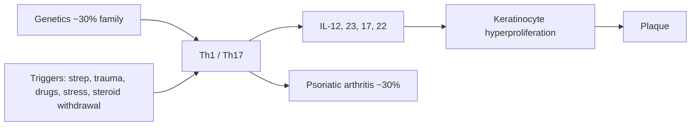

**Level:** #theory #practical #viva #papulosquamous

**Book pages:** 132 to 142 (chapter 10)

> [!success] CORE CARD (2 minutes)
> - **What:** chronic immune-mediated disease, **skin + joints**. Peaks at **20-30** and **50-60**. /~**30%** have a 1st-degree relative.
> - **Waxes and wanes** for life, modified by starting/stopping treatment, **few spontaneous remissions**.
> - **group:** papulosquamous
> - **lesion:** well-defined red plaque
> - **scale:** thick silvery lamellar
> - **pathogenesis:** Complex genetic disease + environment. **Hyperproliferative** state → thick skin and excess scale. Proliferation is driven by **cytokines from immune cells**, so systemic drugs target these cytokines/cells.
**Activated T cells: Th1, Th17 → IL-17, IL-12, IL-23, IL-22.**
Epidermal cells accumulate; **transit time 28 days → 2-3 days**. Most therapies suppress the responsible T cells.
> - **Recognize:** symmetric well-demarcated **silvery plaques** (scalp, elbows, knees, sacrum) ± **nails** (pitting, oil-drop) ± **DIP/dactylitis**.
> - **Signs:** candle-grease ➕ → **Auspitz** → [[Koebner phenomenon]].
> - **Types:** Plaque (80-90%) · Guttate · Inverse · Erythrodermic · Pustular · Palmoplantar.
> - **Sites:** Scalp, elbows, knees, sacrum.
> - **Treat:** 1st line is high-potency topical steroid with or without vitamin D analog/ PsA → systemic ([[Phototherapy]], [[Methotrexate]], biologics).
> - **Never:** oral steroids (exception: pregnant + pustular). 
> - **Admit:** erythrodermic, generalized pustular.
**Take-home:** Psoriasis is a skin disease with a joint and a heart-risk side. Treat the skin, look for the joints, and never give oral steroids.
### Revise in 3 ways
| Time you have | Do this                                               |
| ------------- | ----------------------------------------------------- |
| 2 min         | Core card above                                       |
| 20 min        | [[Psoriasis - Theory]] then [[Psoriasis management]] |
| Active recall | [[Psoriasis - Exam]] (traps, questions, flashcards)   |
| Tell it apart | [[Papulosquamous DDx]]                                |

### Study Psoriasis 

- [[Psoriasis Pathogenesis]]: why the skin builds up
- [[Psoriasis Clinical Types]]: plaque, guttate, erythrodermic, pustular, flexural, palmoplantar
- [[Psoriasis Special Sites]]: scalp, nails, mouth, joints
- [[Psoriasis Signs Histology and Dermoscopy]]: the signs and the proof
- [[Papulosquamous DDx]]
- [[Psoriasis management]]
- [[Psoriasis Triggers Drugs and Comorbidities]]

### Connections

- **Looks like:** [[Lichen Planus]] (flat violet itchy papules, Wickham striae), [[Pityriasis Rosea]] (herald patch, collarette), [[Seborrheic Dermatitis]] (greasy scale, face and folds), [[Tinea Corporis]] (KOH shows hyphae), [[Secondary Syphilis]] (coppery, palms and soles, serology)
- **Same sign:** Koebner with [[Lichen Planus]] and vitiligo. Nail pitting with [[Alopecia]] (alopecia areata)
- **Same test:** biopsy with [[Lichen Planus]]; see [[Skin Structure and Histology]] for the terms
- **Triggered by:** streptococcal infection (guttate), steroid withdrawal (pustular)
- **Can lead to:** [[Erythroderma]], psoriatic arthritis
- **Treated with the same things as:** [[Lichen Planus]] (phototherapy, acitretin), [[Pityriasis Rosea]] (phototherapy)

See also: [[Papulosquamous Lesions]], [[Papulosquamous Comparison]]